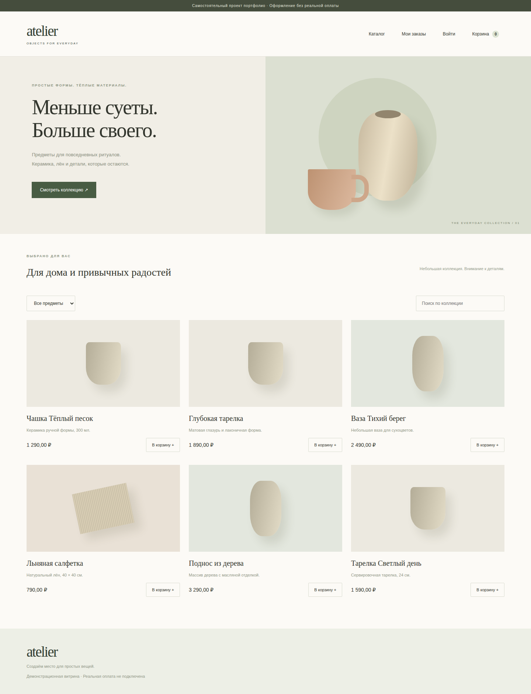
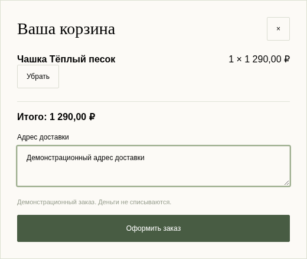

# Atelier Commerce

Самостоятельный проект портфолио с Python backend. Планируемый стек: FastAPI, SQLAlchemy, PostgreSQL, pytest; frontend — JavaScript. Без платных сервисов и реальных платежей.

Реализованы FastAPI REST API, SQLAlchemy, cookie-авторизация, роли клиента/администратора, каталог, корзина, оформление и история заказов, управление товарами и статусами. Остатки и заказ изменяются одной транзакцией; ключ идемпотентности защищает от повторного списания. Цены хранятся целыми копейками и сохраняются снимками в строках заказа.

## Локальный запуск

Нужен Python 3.14, проверенный в CI. Создайте отдельное окружение и установите `pip install -r requirements.lock`. Затем:

```sh
python -m app.seed --catalog
uvicorn app.main:create_app --factory --host 127.0.0.1 --port 8000
```

Откройте http://localhost:8000. Создайте клиентский аккаунт с паролем от 12 символов. Администратор создаётся отдельно: `python -m app.seed --admin-email admin@example.test`; пароль вводится скрыто через getpass, встроенного пароля нет. Скрипт не повышает права существующего аккаунта и не перезаписывает заполненный каталог.

## Docker и PostgreSQL

Создайте `.env` с `POSTGRES_PASSWORD=` и своим случайным паролем из букв и цифр. Файл исключён из Git. Запустите `docker compose up --build -d`, затем `docker compose exec store python -m app.seed --catalog`. База хранится в именованном томе, наружу открыт только localhost:8000. Для администратора используйте `docker compose exec store python -m app.seed --admin-email EMAIL`.

Для публичного HTTPS нужны TLS proxy, ENVIRONMENT=production и точный APP_ORIGIN. По умолчанию приложение предназначено для локальной демонстрации.

## Проверки

`pytest -q` локально: 9 passed, 1 skipped (PostgreSQL не настроен). [CI 43856654118](https://github.com/rvrhxg/E-commerce-Platform/actions/runs/43856654118) выполнил также PostgreSQL-тест: два потока покупают последнюю единицу, успешен только один. Docker build и Chromium-сценарий регистрации/корзины/оформления заказа прошли. [CI 43858094326](https://github.com/rvrhxg/E-commerce-Platform/actions/runs/43858094326) подтвердил Docker runtime с PostgreSQL, сохранение заказа после перезапуска и непривилегированный UID.

Реальные desktop/mobile, корзина и заказ проверены визуально. Формы и данные тестов вымышленные. Декоративные изображения выполнены CSS и не являются фотографиями товаров.

## Ограничения

Реальных платежей нет, деньги не списываются. Корзина хранится в памяти вкладки. Каталог/история ограничены 200 записями; нет доставки через внешние службы, уведомлений, восстановления пароля и версионированных миграций. Перед эксплуатацией нужны общий rate limiter и ограничение параллельного хеширования. `create_all` предназначен для первой инициализации, а не миграций существующей production-базы.

[Архитектура и транзакции](docs/ARCHITECTURE.md).

## Скриншоты




[Мобильная версия](docs/screenshots/store-mobile.png) · [История заказа](docs/screenshots/order.png)
